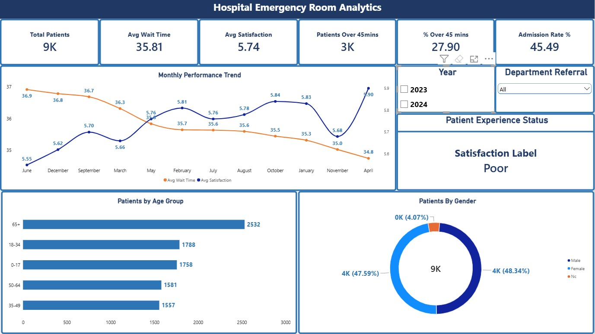

# 🏥 Hospital Emergency Room Analytics

## 📋 Business Problem

City General Hospital's Emergency Room is experiencing 
increasing patient complaints about long wait times and 
low satisfaction scores. Hospital management needs 
data-driven insights to improve operations.

## 🎯 Objective

Build a complete end-to-end analytics solution to:
- Identify peak hours causing longest wait times
- Analyze department-level performance gaps
- Segment patients by experience quality
- Deliver actionable recommendations to management

## 📊 Key Findings

| Finding | Insight |
|---------|---------|
| ⏱️ Peak Hours | Wait time jumps 84% from 24.9 to 45.9 mins at 8am |
| 🏥 Worst Dept | Neurology — 36.40 min wait, 5.69/10 satisfaction |
| 🏆 Best Dept | Cardiology — 35.23 min wait, 5.82/10 satisfaction |
| 🚨 Critical | 456 patients (4.95%) waited 67+ mins, scored 2.48/10 |
| 💡 Quick Win | Matching Cardiology performance could lift satisfaction to 7.0+ |

## 🛠️ Tools & Techniques

| Tool | Usage | Techniques |
|------|-------|-----------|
| Python | Data cleaning & EDA | Pandas, Matplotlib, Seaborn, Functions, Docstrings |
| MySQL | Data analysis | CTEs, Window Functions, RANK(), LAG(), Views |
| Power BI | Interactive dashboard | DAX Measures, CALCULATE, VAR/RETURN, Conditional formatting |
| Excel | Pivot dashboard | Power Query, Pivot Tables, Slicers, Charts |

## 📁 Project Structure

## 📸 Dashboard Screenshots

### Power BI — Executive Summary

### Power BI — Operations & Peak Hours

### Power BI — Department & Patient Analysis

### Power BI — Business Recommendations

### Excel Dashboard

## 💡 Business Recommendations

1. **Increase staffing by 30%** during 8am-12pm peak window
2. **Review Neurology scheduling** — specialist availability issue
3. **Implement 60-min alert system** for at-risk patients
4. **Replicate Cardiology model** across all departments

## 🎯 Expected Impact

Implementing these recommendations could:
- Reduce peak wait time from 45 mins → below 35 mins
- Improve satisfaction from 5.74 → 7.5/10
- Reduce critical experience patients from 456 → below 200

## 👨‍💻 Analyst

**Ovean S** | Data Analyst
📧 ovean14272000@gmail.com
🔗 [LinkedIn](https://www.linkedin.com/in/ovean-sugirdas)
🐙 [GitHub](https://github.com/ovean1414)

